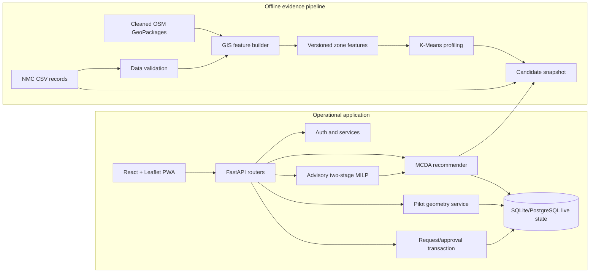
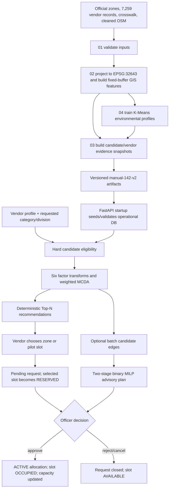

# 1. Project overview and actual implementation inventory

## Problem and users

VendorMap addresses a municipal decision problem: Nashik has official vending/no-vending zone records, historical vendor records, incomplete geographic references, finite capacity, and competing vendor preferences. Officers need a traceable way to explore eligible zones, maintain live status, review vendor requests, map provisional physical slots, and approve allocations. Vendors need authentication, profiles, recommendations, request tracking, maps, and their active allocation.

This is a better description than “find the best place for a vendor.” The code never claims profitability, guaranteed footfall, legal permission, or predictive success (`backend/recommendation/mcda_engine.py:1805-1834`).

The roles are:

- **Vendor:** OTP login, onboarding/profile, recommendation exploration, slot/zone request, request cancellation, allocation/activity view, navigation for authorized pilot layouts (`backend/routers/auth.py`, `backend/routers/vendors.py`, `backend/routers/recommendations.py`, `backend/routers/allocations.py`).
- **NMC admin/officer:** username/password login, dashboards, vendors, zones and capacity, applications, pilot slot workspace, approvals/rejections, and advisory batch plans (`frontend/src/app/ImplementationApp.jsx:11-27`; `backend/routers/allocations.py:312-678`).
- **Researcher/project team:** offline validation, GIS feature building, clustering, MCDA sensitivity, business-aware experiments, and expert/AHP utilities (`scripts/01_validate_data.py` through `scripts/10_evaluate_business_aware_mcda.py`).

## Technology stack

| Layer | Actual technology | Why it is used | Evidence |
|---|---|---|---|
| UI | React 18, Vite 6, Leaflet/react-leaflet, lucide-react | component UI, build/dev server, interactive maps, icons | `frontend/package.json` |
| API | FastAPI, Pydantic, Uvicorn | typed HTTP endpoints and ASGI serving | `backend/application.py`; `backend/requirements/app.txt` |
| Operational DB | SQLAlchemy Core; SQLite default; PostgreSQL supported | portable transactions, constraints and migrations | `backend/repositories/database.py:1-47` |
| GIS | GeoPandas, Shapely, PyProj | spatial IO, buffers, intersections, projections and geometry validation | `scripts/02_build_zone_features.py`; `backend/geo/pilot_geometry.py` |
| Numeric/ML | pandas, NumPy, scikit-learn, joblib | tables, transformations, K-Means and saved artifact | `scripts/04_train_kmeans.py` |
| Optimization | SciPy `milp`/HiGHS | binary capacity-constrained allocation planning | `backend/allocation/allocation_optimizer.py:29-40` |
| Authentication | signed/hash-based sessions, OTP console or MessageCentral | vendor phone verification and admin sessions | `backend/services/authentication.py`; `backend/core/config.py` |
| Optional explanation | Gemini, server-side, bounded and validated | natural-language explanation grounded in recomputed evidence | `backend/services/ai_zone_explanations.py` |
| Optional messaging | Meta WhatsApp Cloud API | conversational vendor workflow | `backend/whatsapp/` |

## Actual capability inventory

| Capability | Status | Accurate defence |
|---|---|---|
| Official zone/vendor ingestion | Implemented | Versioned CSV inputs and operational seeding exist. |
| OSM GIS feature extraction | Implemented offline | 250/500 m features are precomputed, not recomputed on every request. |
| Six-factor MCDA | Implemented/active | Weighted sum with missing-factor renormalization and hard eligibility filters. |
| Personalized weights | Implemented/active | Mild/controlled profile-based policy; current v2 uses a 40% baseline + 60% priority blend and multiplier 3.0. |
| K-Means | Implemented offline | Profiles environmental contexts; cluster label is descriptive and does not alter MCDA ranking. |
| DBSCAN/OPTICS | Not implemented | No code or artifact uses them. |
| Business-aware MCDA | Implemented/experimental | Disabled by default via `BUSINESS_AWARE_MCDA_EXPERIMENT=false`. |
| Proximity ranking | Implemented/experimental | Disabled by default via `LOCATION_RANKING_EXPERIMENT=false`. |
| AHP | Utility only | Pairwise calculations and policy saving exist; active weights remain documented policy assumptions, not expert-validated AHP weights. |
| Random forest/SHAP | Synthetic research demo only | Not the operational recommender. |
| Pilot slot generation | Pilot/provisional | Automated 10-slot Lekha Nagar layout, three imported layouts, and one interactive drawing canvas. |
| Automatic citywide slot generation | Not implemented | Slot geometry exists only for controlled pilot layouts. |
| Goal-programming allocation | Implemented/advisory | Two-stage binary MILP produces a read-only plan. |
| Approval/allocation transaction | Implemented/active | Admin approval commits allocation and slot occupancy. |
| Legality proof/permit issuance | Not implemented | FREE status is an eligibility input; site verification and legal authorization remain external. |

## System architecture



# 2. Real end-to-end pipeline diagram

The real execution is not one synchronous chain. It has an offline branch and a runtime branch.



## Stage-by-stage pipeline

| Stage | Input and processing | Output/failure behavior | Code |
|---|---|---|---|
| Validate | checks required columns, unique IDs, numeric quality and source manifests | fails fast; raw data stays unchanged | `scripts/01_validate_data.py` |
| Resolve reference geometry | combines official analytical geometry and 142 manually pinned FREE-zone points; v2 has 258 usable references and 50 missing | invalid/missing references remain unavailable, never silently zero | `scripts/02_build_zone_features.py:202-323` |
| GIS features | converts to UTM 43N, builds 250/500 m point buffers, nearest distances, counts, clipped line lengths/densities, and land-use union ratios | versioned CSV/GPKG; invalid spatial files abort | `scripts/02_build_zone_features.py:325-503` |
| K-Means | log1p, percentile clipping, median imputation, standardization, group balancing, K=2..8 experiment | artifact, labels, profiles and metrics; cluster is descriptive | `scripts/04_train_kmeans.py:55-204` |
| Training/candidate snapshots | joins GIS, cluster, official and historical association evidence | 166-row snapshot; 146 FREE candidates before live capacity in saved metrics | `scripts/03_build_training_data.py` |
| Startup | validates config/database, creates/upgrades schema, seeds 308 zones and historical auth identities | application refuses unsafe/invalid production configuration | `backend/bootstrap.py`; `backend/core/lifecycle.py` |
| Eligibility | keeps FREE zones with usable references; optionally requires OPEN, positive capacity, and recent officer verification; division is strict | empty recommendation is a valid outcome | `backend/recommendation/mcda_engine.py:696-904,1581-1678` |
| MCDA | builds business, commercial, access, facilities, preference and historical factors; weighted sum | scores 0-100 plus coverage and contributions | `backend/recommendation/mcda_engine.py:912-1485` |
| Ranking | score descending, original score descending, zone ID ascending; Top-N 1..20 | deterministic ties; no cross-division fill | `backend/recommendation/mcda_engine.py:1854-1998` |
| Request | validates vendor, zone/slot availability and conflicts; reserves selected slot | transactional pending request or clear conflict | `backend/repositories/database.py:1264-1384` |
| Approval | locks current state, handles relocation, creates allocation, occupies slot, updates audit/capacity | atomic commit or rollback | `backend/repositories/database.py:1646-1846` |
| Batch plan | scores each vendor, forms feasible edges, solves two lexicographic MILPs | advisory result only; no DB write | `backend/allocation/allocation_optimizer.py:958-1746` |

## Worked real flow: zone `NW_F_025`

The stored baseline recommendation row identifies `NW_F_025`, Balaji Temple/Tilbhandeshwar Lane, as a FREE Nashik West zone with a manually pinned, unverified analytical reference. Around that point the saved features include major-road distance 268.65 m, bus-access distance 390.79 m, 8 commercial POIs within 250 m, 5 markets within 500 m, 6 food POIs within 500 m, and 3 toilets plus 6 parking features within 500 m (`data/model/versions/manual-142-v2/recommendations/recommendations.csv`).

Those values become normalized factor scores: business 0.629799, commercial 0.829188, access 0.729135, facilities 0.5625, preference 0.5, historical 0.950619. With the stored balanced weights, the score is:

`100 × (0.25×0.629799 + 0.20×0.829188 + 0.20×0.729135 + 0.15×0.5625 + 0.10×0.5 + 0.10×0.950619) = 69.8551`.

That is a suitability ranking score, not a probability. The row is `EXPLORATORY_UNVERIFIED`: its reference is not surveyed and it has no verified live capacity in that offline artifact. It can be shown in research results, but a production allocation requires operational status/capacity and officer approval.

# 3. Datasets and suitability factors

## Dataset inventory

| Dataset | Format / inspected size | Important fields | Use and source status |
|---|---:|---|---|
| `data/raw/nmc/official_zones.csv` | CSV, 308 rows | zone ID, division, type, capacity, description | canonical NMC-derived zone master |
| `data/raw/nmc/vendors.csv` | CSV, 7,259 rows | identity, phones, business, location text | historical municipal registry evidence |
| `location_zone_crosswalk.csv` | CSV, 528 rows | normalized location, proposed/reviewed zone, score/status | text association; not verified success |
| `zone_vendor_evidence.csv` | CSV, 308 rows | category counts, evidence status, capacity fields | aggregated historical evidence |
| OSM cleaned layers | 13,988 roads; 353 commercial points; 401 land-use polygons; 61 transport points; 373 facility points | classified tags and geometry | OpenStreetMap-derived environmental context; incomplete coverage |
| `zone_features.csv` | CSV/GPKG, 308 rows, 258 usable references | distances, counts, densities, land-use ratios | precomputed GIS features in EPSG:32643 |
| `candidate_zone_snapshot.csv` | CSV, 166 rows | FREE/candidate metadata, features, cluster, history | active MCDA input snapshot |
| `vendor_training_registry.csv` | CSV, 7,259 rows | category, association, split | historical research registry; no outcome label |
| K-Means outputs | CSV + joblib; 258 training rows | cluster, centroid distance, profiles | environmental description |
| pilot GeoJSON | 2 Lekha boundaries; 81 features across 3 imported zones | boundaries, slot polygons and provenance | explicitly provisional/not surveyed |

Dataset provenance is recorded in `data/catalog.json`, `reports/data_quality/feature_build_metrics.json`, and `reports/data_quality/training_data_metrics.json`. The repository has zero independent suitability labels; therefore it makes no accuracy/F1/AUC claim.

## Factor table: what actually affects baseline MCDA

| Factor | Source/calculation | Weight | Direction and type | Missing data/effect | Code |
|---|---|---:|---|---|---|
| Business compatibility | smoothed share of same-category historical text associations; lift transformed by `log1p(lift)/log(3)` and reliability-shrunk toward 0.5 | 0.25 | higher helps; contextual soft factor | omitted if category prior absent; self/location group removed for an existing vendor | `mcda_engine.py:1054-1296` |
| Commercial context | mean of saturated commercial POIs 250 m (scale 12), markets 500 m (4), food POIs 250 m (8) | 0.20 | higher helps; soft environmental factor | available components averaged; all missing stays missing | `mcda_engine.py:918-951` |
| Access | mean of `exp(-major-road distance/400)`, `exp(-bus distance/1000)`, and saturated pedestrian-road density (scale 5000) | 0.20 | nearer/more helps; soft factor | same missing handling | `mcda_engine.py:954-987` |
| Facilities | mean of saturated healthcare (15), education (6), toilet (3), parking (4) counts within 500 m | 0.15 | higher helps; soft factor | same missing handling | `mcda_engine.py:990-1033` |
| Division preference | neutral 0.5 when no division; when selected it becomes a hard filter and weight is redistributed | 0.10 baseline | eligibility, not a double scoring bonus | cannot fill from another division | `decision_policy.py:177-210`; `mcda_engine.py:1342-1361,1621-1638` |
| Historical evidence density | `log1p(zone evidence count)/log1p(50)` clipped to 1 | 0.10 | higher means more evidence, not better demand | zero becomes 0; factor is distinct from business mix | `mcda_engine.py:1299-1334` |

Hard constraints are separate: zone type must be FREE; reference geometry must be usable; excluded/current relocation zone is removed; optional live mode requires OPEN and positive capacity; verified mode additionally requires an officer, timestamp no older than seven days, and positive capacity (`mcda_engine.py:725-899`). A high score cannot override them.

Factors present in the feature table but **not** in baseline MCDA include raw road density, bus count, rail distance, retail/service subtypes, land-use shares, capacity, geometry area, cluster ID, and competition. Retail/service subtypes affect only the disabled-by-default business-aware experiment. Land-use features were excluded because mapped composition is sparse (only 74 of 308 rows have reliable mapped-share values in the saved report). Competition scoring is explicitly disabled in `mcda_configuration.json`.

The system has no observed pedestrian footfall, sales, rent model, crime/safety dataset, road width dataset, measured pavement availability, intersection score, or authoritative legal polygon coverage. Pedestrian-road density and POI counts are proxies, not observations of demand.

## Coordinate and geometry operations

- Raw/display coordinates use WGS84/CRS84 (longitude, latitude).
- Metric analysis uses `EPSG:32643`, UTM zone 43N, so buffers and distances are metres (`scripts/02_build_zone_features.py:32`).
- Every usable zone uses a representative point; buffers are fixed circles of 250 and 500 m, never the size of the zone polygon (`scripts/02_build_zone_features.py:381-415`).
- The spatial index first performs bounding-box search, followed by exact `intersects`; nearest distance uses the GeoPandas/STRtree spatial index (`scripts/02_build_zone_features.py:171-191`).
- Road density is clipped road length inside a buffer divided by buffer area in km² (`scripts/02_build_zone_features.py:438-445`).
- Land-use polygons are unioned before area division to avoid double-counting overlap. Conditional mapped shares are withheld below 10% classified coverage (`scripts/02_build_zone_features.py:446-469`).
- Runtime experimental vendor-to-zone distance uses Haversine with Earth radius 6371.0088 km (`backend/recommendation/location_ranking.py:92-119`).

# 4. MCDA implementation and worked example

MCDA combines unlike evidence after each criterion is transformed to the common 0-1 direction “higher is better.” The implemented method is a missing-data-aware weighted sum, not TOPSIS and not AHP. AHP utilities exist for future reviewed calibration; active baseline weights are policy assumptions (`backend/recommendation/decision_policy.py:47-67`).

For zone `z`, factor score `s_iz`, weight `w_i`, and availability indicator `a_iz`:

`Score(z) = 100 × Σ(w_i s_iz) / Σ(w_i a_iz)`.

`Coverage(z) = Σ(w_i a_iz)` and each displayed contribution is `100 w_i s_iz / Coverage(z)`. Missing factors are omitted, not set to zero (`mcda_engine.py:1369-1485`). Ties resolve by original MCDA score and then ascending zone ID. There is no “suitable/unsuitable” score threshold; eligibility is rule-based and the remaining candidates are ranked.

The complete `NW_F_025` calculation is given above. Its six contributions are 15.74498 + 16.58376 + 14.58270 + 8.43750 + 5.00000 + 9.50619 = 69.85513, matching the saved output.

Current personalization is configurable, but versioned and bounded. The active v2 policy starts with the six baseline weights. It multiplies the selected priority/checkbox factor by 3, normalizes that distribution, then blends 40% baseline with 60% priority distribution (`mcda_configuration.json`; `decision_policy.py:331-393`). When a division is selected, the 0.10 preference weight is removed and the other weights are proportionally renormalized. Location and vendor-requirement rerankers exist, but are experimental/demo-controlled and must not be described as universally active.

Why MCDA rather than an ML classifier: there are no independent positive/negative suitability outcomes, zero is not a negative label, rules must be explainable, and municipal constraints must remain explicit. A classifier trained on historical presence would learn past concentration and data-collection bias, not proven suitability.

# 5. Clustering algorithms and complete pipeline

Only K-Means is implemented in the active environmental clustering pipeline. DBSCAN and OPTICS are absent.

The 12 clustered variables are major-road distance, total and pedestrian road density, commercial/market/food counts, bus count and bus distance, and healthcare/education/toilet/parking counts (`scripts/04_train_kmeans.py:33-43`). Coordinates, division, type, capacity, occupancy, vendor history, category and MCDA score are excluded.

Preprocessing is: `log1p` all nonnegative values; clip each feature at its 1st/99th training percentiles; median-impute; StandardScaler; multiply each feature by `1/sqrt(number of variables in its group)` so road, commercial, transport and facilities groups have equal aggregate influence (`scripts/04_train_kmeans.py:55-76`). K-Means then uses Euclidean distance in this transformed feature space, `n_init=20`, seeds 42-46 for evaluation, and final `random_state=42`.

K was evaluated from 2 through 8 in the training script. A K is eligible only if all five trials finish, median pairwise ARI ≥ 0.80, and minimum cluster size ≥ `max(5, ceil(3% of 258)) = 8`. The highest mean silhouette wins, with the smaller K selected if within 0.01. Active K=2 has silhouette 0.340629, Davies-Bouldin 1.464529, Calinski-Harabasz 102.8891, inertia 736.1383, ARI stability 1.0, and cluster sizes 83 and 175 (`kmeans_run.json`).

K-Means alternates assignment to the nearest centroid and centroid recomputation until scikit-learn's convergence condition or iteration limit. In a tiny conceptual example after the real preprocessing, points `(0,0),(0.2,0.1)` lie nearer centroid A `(0.1,0.05)`, while `(2,2),(2.2,1.9)` lie nearer B `(2.1,1.95)`; assignments and means repeat until unchanged. The real model uses 12 dimensions, not latitude/longitude.

Clusters are appended as `environment_cluster` to candidate artifacts. They explain environmental profiles; they do not feed the six-factor score and do not cause recommendations. K-Means limitations are spherical/equal-variance preference, sensitivity to scaling/outliers, forced assignment of every point, arbitrary label numbers, and no spatial contiguity guarantee.

# 6. Slot formation and geometric rules

## What a slot is

A slot is a persisted rectangular GeoJSON footprint within a pilot layout, with a compound `(zone_id, slot_id)`, width/depth, UTM center, WGS84 geometry, status (`AVAILABLE`, `RESERVED`, `OCCUPIED`, `BLOCKED`), optional vendor/request/allocation links, provisional validation state, timestamps and event history (`backend/repositories/database.py:270-307`).

There are three different creation paths:

1. `NN_F_013`: deterministic generation inside two user-drawn boundaries, up to five 2 m × 2 m slots per boundary.
2. `PAN_F_019`, `SAT_F_014`, `NR_F_003`: exact supplied geometries are imported, never regenerated or repaired; counts 10, 35 and 30.
3. `PAN_F_031`: officer-drawn provisional rectangles; no position is invented automatically.

## Automated Lekha Nagar algorithm

Constants are UTM 43N, slot 2×2 m, default minimum spacing 0.5 m, default pedestrian corridor 1.2 m, search increment 0.25 m, geometry tolerance 0.002 m, and maximum ten slots (`backend/geo/pilot_geometry.py:19-25,106-124,134-199`).

```text
for each of the two source polygons:
    project WGS84 polygon to EPSG:32643
    choose configured angle or longest edge of minimum rotated rectangle
    rotate polygon into the search frame
    scan possible y and x positions in deterministic 0.25 m steps
    construct a 2×2 m candidate and adjoining continuous clearance strip
    reject if candidate/strip is outside polygon, too close to previous slot,
           or intersects a recorded obstruction
    retain the longest continuous valid run, capped at five
    rotate footprints/corridor back and convert to WGS84
assign S001..S005 to boundary A and S006..S010 to boundary B
validate dimensions, containment, corridor adjacency, spacing and overlap
```

The code is a conservative grid search, not a global packing optimizer and not measured pavement orientation (`pilot_geometry.py:294-370`). It prevents duplicate IDs, overlap area above 0.0001 m², distance below configured spacing (with tolerance), corridor overlap, and obstruction intersection. A valid slot is wholly covered by its parent (with 2 mm tolerance), rectangular, exactly 4 m², and adjoining but not intersecting the corridor.

Saved validation reports 10 slots, five per boundary, 0.5 m minimum spacing, 1.2 m corridor, and sub-nanometre numerical edge error; it also says site verification and live routing tests are false (`reports/pilot_slots/geographic_validation.json`).

## Slot-state vocabulary

- **Candidate footprint:** geometry considered during search; not persisted.
- **Valid slot:** candidate passing geometry rules.
- **Recommended zone:** MCDA-ranked zone; not automatically a physical slot.
- **Reserved slot:** selected in a PENDING request.
- **Allocated slot:** ACTIVE allocation; physical status OCCUPIED.

There is no universal “recommended slot” algorithm. A vendor/officer selects an available slot in a pilot zone. Suitability is zone-level; slot geometry is site-level.

# 7. Vendor allocation and optimization

Vendors store identity/type, business category, preferred division/locality, working latitude/longitude/radius, operating period, required space, budget, priority profile, market/transport/parking preferences, language and status (`backend/repositories/database.py:54-64`; `backend/services/vendors.py`). Not every stored requirement affects the active baseline MCDA: required space, operating period and budget are not baseline factors.

## Transactional operational allocation

A vendor submits a NEW_ALLOCATION or RELOCATION request for a zone and optional slot. The DB enforces one pending vendor-zone request, one pending request per slot, one active allocation per vendor, and one active allocation per slot. A chosen AVAILABLE slot becomes RESERVED. An admin approves or rejects; approval creates an ACTIVE allocation, updates relocation state/capacity, marks the slot OCCUPIED, and writes audit/event records. Reject/cancel returns the reservation to AVAILABLE (`database.py:119-177,1264-1426,1646-1846`). This is not first-come-first-served auto-approval; officer review is authoritative.

## Advisory goal-programming optimizer

For a batch, each eligible vendor-zone pair is a binary `x_vz`; each vendor has binary unassigned `u_v`.

Hard constraints:

- `Σ_z x_vz + u_v = 1` for every vendor.
- `Σ_v x_vz ≤ capacity_z` for every zone.
- all variables are binary; only eligible, positive-known-capacity edges exist.

Stage 1 minimizes `Σ_v u_v`, maximizing the number assigned. Stage 2 fixes that optimum and minimizes:

`Σ_vz x_vz [1.0(1-score_vz/100) + 0.10 fallback_vz + 0.05(1-coverage_vz)]`.

Defaults are verified live data required, all eligible candidates, max 500 vendors, 30-second limit and zero relative MIP gap (`allocation_optimizer.py:97-137,958-1461`). SciPy `milp` uses HiGHS. Vendors with no edge remain feasible via `u_v=1`; solver failure raises an explicit optimization error. The result is advisory and never writes, reserves, approves or permits anything.

Small example: vendors A and B both can use zone X (capacity 1), while A can also use Y. If A-X score is 90, A-Y 80, and B-X 85, Stage 1 assigns both by choosing A-Y and B-X. Greedy A-X first would leave B unassigned. Stage 2 selects the best cost among all maximum-cardinality plans. Fairness here means maximizing coverage of vendors before score quality, not demographic parity or waiting-time fairness; those are not implemented.

