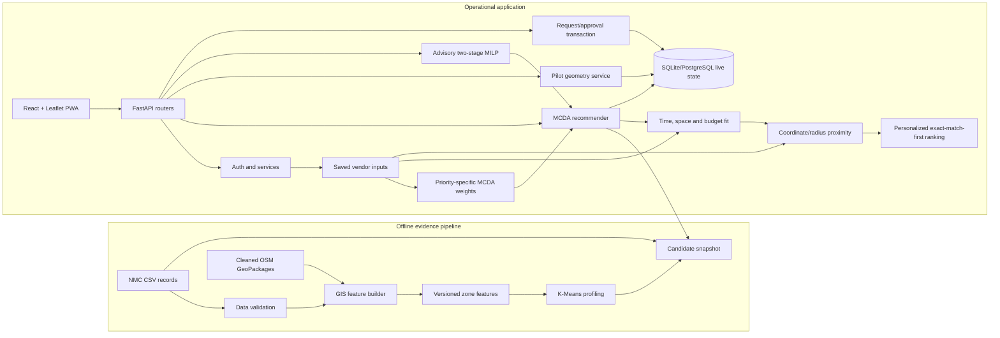
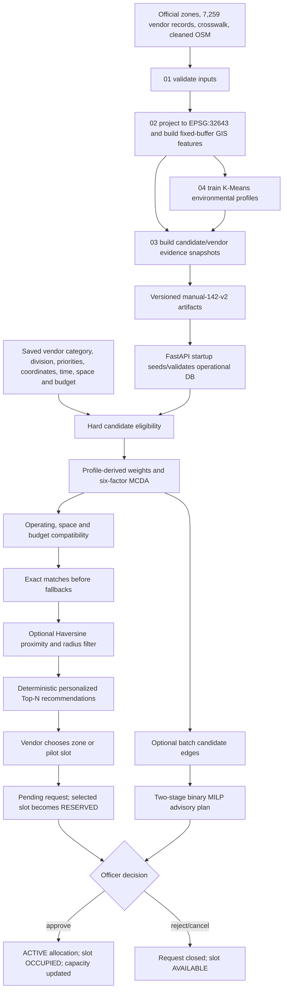

# VendorMap — Complete Technical Understanding and Viva Preparation

This is the single-file edition of the source-verified VendorMap viva guide. It distinguishes active behavior, experimental behavior, pilot/provisional behavior, utilities, and features that are not implemented.

> Core defence: VendorMap is not one monolithic AI model. It separates offline GIS feature engineering and K-Means environmental profiling, six-factor weighted-sum MCDA, vendor-specific reranking, provisional slot geometry, audited officer approval, and an advisory two-stage mixed-integer allocation planner. K-Means does not generate slots; MCDA does not grant permits; the optimizer does not write allocations; and an analytical map reference is not proof of legal authorization.

## Contents

1. Project overview and actual implementation inventory
2. Real end-to-end pipeline diagram
3. Datasets and suitability factors
4. MCDA implementation and worked example
5. Clustering algorithms and complete pipeline
6. Slot formation and geometric rules
7. Vendor allocation and optimization
8. Architecture and code execution flow
9. Important formulas and parameters
10. Technical design decisions and alternatives
11. Live demo presentation script
12. Results, validation, and limitations
13. Eighty project-specific viva questions and answers
14. Complete explanation at five levels
15. One-page revision cheat sheet

# 1. Project overview and actual implementation inventory

## Problem and users

VendorMap addresses a municipal decision problem: Nashik has official vending/no-vending zone records, historical vendor records, incomplete geographic references, finite capacity, and competing vendor preferences. Officers need a traceable way to explore eligible zones, maintain live status, review vendor requests, map provisional physical slots, and approve allocations. Vendors need authentication, profiles, recommendations, request tracking, maps, and their active allocation.

This is a better description than “find the best place for a vendor.” The code never claims profitability, guaranteed footfall, legal permission, or predictive success (`backend/recommendation/mcda_engine.py:1805-1834`).

The roles are:

- **Vendor:** OTP login, onboarding/profile, recommendation exploration, slot/zone request, request cancellation, allocation/activity view, navigation for authorized pilot layouts (`backend/routers/auth.py`, `backend/routers/vendors.py`, `backend/routers/recommendations.py`, `backend/routers/allocations.py`).
- **NMC admin/officer:** username/password login, dashboards, vendors, zones and capacity, applications, pilot slot workspace, approvals/rejections, and advisory batch plans (`frontend/src/app/ImplementationApp.jsx:11-27`; `backend/routers/allocations.py:312-678`).
- **Researcher/project team:** offline validation, GIS feature building, clustering, MCDA sensitivity, business-aware experiments, and expert/AHP utilities (`scripts/01_validate_data.py` through `scripts/10_evaluate_business_aware_mcda.py`).

## Technology stack

| Layer | Actual technology | Why it is used | Evidence |
|---|---|---|---|
| UI | React 18, Vite 6, Leaflet/react-leaflet, lucide-react | component UI, build/dev server, interactive maps, icons | `frontend/package.json` |
| API | FastAPI, Pydantic, Uvicorn | typed HTTP endpoints and ASGI serving | `backend/application.py`; `backend/requirements/app.txt` |
| Operational DB | SQLAlchemy Core; SQLite default; PostgreSQL supported | portable transactions, constraints and migrations | `backend/repositories/database.py:1-47` |
| GIS | GeoPandas, Shapely, PyProj | spatial IO, buffers, intersections, projections and geometry validation | `scripts/02_build_zone_features.py`; `backend/geo/pilot_geometry.py` |
| Numeric/ML | pandas, NumPy, scikit-learn, joblib | tables, transformations, K-Means and saved artifact | `scripts/04_train_kmeans.py` |
| Optimization | SciPy `milp`/HiGHS | binary capacity-constrained allocation planning | `backend/allocation/allocation_optimizer.py:29-40` |
| Authentication | signed/hash-based sessions, OTP console or MessageCentral | vendor phone verification and admin sessions | `backend/services/authentication.py`; `backend/core/config.py` |
| Optional explanation | Gemini, server-side, bounded and validated | natural-language explanation grounded in recomputed evidence | `backend/services/ai_zone_explanations.py` |
| Optional messaging | Meta WhatsApp Cloud API | conversational vendor workflow | `backend/whatsapp/` |

## Actual capability inventory

| Capability | Status | Accurate defence |
|---|---|---|
| Official zone/vendor ingestion | Implemented | Versioned CSV inputs and operational seeding exist. |
| OSM GIS feature extraction | Implemented offline | 250/500 m features are precomputed, not recomputed on every request. |
| Six-factor MCDA | Implemented/active | Weighted sum with missing-factor renormalization and hard eligibility filters. |
| Personalized weights | Implemented/active | Mild/controlled profile-based policy; current v2 uses a 40% baseline + 60% priority blend and multiplier 3.0. |
| Vendor requirement reranking | Implemented/demo-active locally | Operating period, required space and budget create exact-match precedence and a 45% compatibility blend; zone requirement values are synthetic demonstration data, not municipal facts. |
| K-Means | Implemented offline | Profiles environmental contexts; cluster label is descriptive and does not alter MCDA ranking. |
| DBSCAN/OPTICS | Not implemented | No code or artifact uses them. |
| Business-aware MCDA | Implemented/experimental, locally enabled | Code default is false, but the current local `.env` enables category-specific commercial GIS scoring. |
| Proximity/radius ranking | Implemented/experimental, locally enabled | Saved coordinates create Haversine distance, proximity decay and optional 1/3/5/10 km filtering; code default remains false. |
| AHP | Utility only | Pairwise calculations and policy saving exist; active weights remain documented policy assumptions, not expert-validated AHP weights. |
| Random forest/SHAP | Synthetic research demo only | Not the operational recommender. |
| Pilot slot generation | Pilot/provisional | Automated 10-slot Lekha Nagar layout, three imported layouts, and one interactive drawing canvas. |
| Automatic citywide slot generation | Not implemented | Slot geometry exists only for controlled pilot layouts. |
| Goal-programming allocation | Implemented/advisory | Two-stage binary MILP produces a read-only plan. |
| Approval/allocation transaction | Implemented/active | Admin approval commits allocation and slot occupancy. |
| Legality proof/permit issuance | Not implemented | FREE status is an eligibility input; site verification and legal authorization remain external. |

## System architecture



# 2. Real end-to-end pipeline diagram

The real execution is not one synchronous chain. It has an offline branch and a runtime branch.



## Stage-by-stage pipeline

| Stage | Input and processing | Output/failure behavior | Code |
|---|---|---|---|
| Validate | checks required columns, unique IDs, numeric quality and source manifests | fails fast; raw data stays unchanged | `scripts/01_validate_data.py` |
| Resolve reference geometry | combines official analytical geometry and 142 manually pinned FREE-zone points; v2 has 258 usable references and 50 missing | invalid/missing references remain unavailable, never silently zero | `scripts/02_build_zone_features.py:202-323` |
| GIS features | converts to UTM 43N, builds 250/500 m point buffers, nearest distances, counts, clipped line lengths/densities, and land-use union ratios | versioned CSV/GPKG; invalid spatial files abort | `scripts/02_build_zone_features.py:325-503` |
| K-Means | log1p, percentile clipping, median imputation, standardization, group balancing, K=2..8 experiment | artifact, labels, profiles and metrics; cluster is descriptive | `scripts/04_train_kmeans.py:55-204` |
| Training/candidate snapshots | joins GIS, cluster, official and historical association evidence | 166-row snapshot; 146 FREE candidates before live capacity in saved metrics | `scripts/03_build_training_data.py` |
| Startup | validates config/database, creates/upgrades schema, seeds 308 zones and historical auth identities | application refuses unsafe/invalid production configuration | `backend/bootstrap.py`; `backend/core/lifecycle.py` |
| Eligibility | keeps FREE zones with usable references; optionally requires OPEN, positive capacity, and recent officer verification; division is strict | empty recommendation is a valid outcome | `backend/recommendation/mcda_engine.py:696-904,1581-1678` |
| MCDA | builds business, commercial, access, facilities, preference and historical factors; weighted sum | scores 0-100 plus coverage and contributions | `backend/recommendation/mcda_engine.py:912-1485` |
| Requirement compatibility | with the local demo flag enabled, compares requested operating period, minimum area and maximum budget with per-zone profiles | 0-100 requirement score, exact-match flag and transparent fallback count; invalid/incomplete demo coverage fails loudly | `backend/recommendation/vendor_requirement_ranking.py` |
| Proximity and radius | if saved coordinates and the experiment flag exist, calculates Haversine distance, exponential proximity and optional 1/3/5/10 km shortlist | nearby personalized ordering; zero results can be explicitly expanded instead of silently ignoring radius | `backend/recommendation/location_ranking.py`; `backend/routers/recommendations.py:270-319` |
| Ranking | exact requirement matches first, then personalized score, original MCDA score and zone ID; Top-N 1..20 | deterministic input-driven results; fallbacks only when exact matches are insufficient; no cross-division fill | `vendor_requirement_ranking.py:86-108`; `location_ranking.py:120-135`; `mcda_engine.py:1889-2104` |
| Request | validates vendor, zone/slot availability and conflicts; reserves selected slot | transactional pending request or clear conflict | `backend/repositories/database.py:1264-1384` |
| Approval | locks current state, handles relocation, creates allocation, occupies slot, updates audit/capacity | atomic commit or rollback | `backend/repositories/database.py:1646-1846` |
| Batch plan | scores each vendor, forms feasible edges, solves two lexicographic MILPs | advisory result only; no DB write | `backend/allocation/allocation_optimizer.py:958-1746` |

## Worked real flow: zone `NW_F_025`

The stored baseline recommendation row identifies `NW_F_025`, Balaji Temple/Tilbhandeshwar Lane, as a FREE Nashik West zone with a manually pinned, unverified analytical reference. Around that point the saved features include major-road distance 268.65 m, bus-access distance 390.79 m, 8 commercial POIs within 250 m, 5 markets within 500 m, 6 food POIs within 500 m, and 3 toilets plus 6 parking features within 500 m (`data/model/versions/manual-142-v2/recommendations/recommendations.csv`).

Those values become normalized factor scores: business 0.629799, commercial 0.829188, access 0.729135, facilities 0.5625, preference 0.5, historical 0.950619. With the stored balanced weights, the score is:

`100 × (0.25×0.629799 + 0.20×0.829188 + 0.20×0.729135 + 0.15×0.5625 + 0.10×0.5 + 0.10×0.950619) = 69.8551`.

That is a suitability ranking score, not a probability. The row is `EXPLORATORY_UNVERIFIED`: its reference is not surveyed and it has no verified live capacity in that offline artifact. It can be shown in research results, but a production allocation requires operational status/capacity and officer approval.

# 3. Datasets and suitability factors

## Dataset inventory

| Dataset | Format / inspected size | Important fields | Use and source status |
|---|---:|---|---|
| `data/raw/nmc/official_zones.csv` | CSV, 308 rows | zone ID, division, type, capacity, description | canonical NMC-derived zone master |
| `data/raw/nmc/vendors.csv` | CSV, 7,259 rows | identity, phones, business, location text | historical municipal registry evidence |
| `location_zone_crosswalk.csv` | CSV, 528 rows | normalized location, proposed/reviewed zone, score/status | text association; not verified success |
| `zone_vendor_evidence.csv` | CSV, 308 rows | category counts, evidence status, capacity fields | aggregated historical evidence |
| OSM cleaned layers | 13,988 roads; 353 commercial points; 401 land-use polygons; 61 transport points; 373 facility points | classified tags and geometry | OpenStreetMap-derived environmental context; incomplete coverage |
| `zone_features.csv` | CSV/GPKG, 308 rows, 258 usable references | distances, counts, densities, land-use ratios | precomputed GIS features in EPSG:32643 |
| `candidate_zone_snapshot.csv` | CSV, 166 rows | FREE/candidate metadata, features, cluster, history | active MCDA input snapshot |
| `vendor_training_registry.csv` | CSV, 7,259 rows | category, association, split | historical research registry; no outcome label |
| `data/demo/zone_requirement_profiles.csv` | CSV, 308 rows | allowed periods, available stall area, monthly fee, source marker | deterministic synthetic demonstration input for dynamic requirement reranking; not reviewed municipal data |
| K-Means outputs | CSV + joblib; 258 training rows | cluster, centroid distance, profiles | environmental description |
| pilot GeoJSON | 2 Lekha boundaries; 81 features across 3 imported zones | boundaries, slot polygons and provenance | explicitly provisional/not surveyed |

Dataset provenance is recorded in `data/catalog.json`, `reports/data_quality/feature_build_metrics.json`, and `reports/data_quality/training_data_metrics.json`. The repository has zero independent suitability labels; therefore it makes no accuracy/F1/AUC claim.

## Factor table: what actually affects baseline MCDA

| Factor | Source/calculation | Weight | Direction and type | Missing data/effect | Code |
|---|---|---:|---|---|---|
| Business compatibility | smoothed share of same-category historical text associations; lift transformed by `log1p(lift)/log(3)` and reliability-shrunk toward 0.5 | 0.25 | higher helps; contextual soft factor | omitted if category prior absent; self/location group removed for an existing vendor | `mcda_engine.py:1054-1296` |
| Commercial context | mean of saturated commercial POIs 250 m (scale 12), markets 500 m (4), food POIs 250 m (8) | 0.20 | higher helps; soft environmental factor | available components averaged; all missing stays missing | `mcda_engine.py:918-951` |
| Access | mean of `exp(-major-road distance/400)`, `exp(-bus distance/1000)`, and saturated pedestrian-road density (scale 5000) | 0.20 | nearer/more helps; soft factor | same missing handling | `mcda_engine.py:954-987` |
| Facilities | mean of saturated healthcare (15), education (6), toilet (3), parking (4) counts within 500 m | 0.15 | higher helps; soft factor | same missing handling | `mcda_engine.py:990-1033` |
| Division preference | neutral 0.5 when no division; when selected it becomes a hard filter and weight is redistributed | 0.10 baseline | eligibility, not a double scoring bonus | cannot fill from another division | `decision_policy.py:177-210`; `mcda_engine.py:1342-1361,1621-1638` |
| Historical evidence density | `log1p(zone evidence count)/log1p(50)` clipped to 1 | 0.10 | higher means more evidence, not better demand | zero becomes 0; factor is distinct from business mix | `mcda_engine.py:1299-1334` |

Hard constraints are separate: zone type must be FREE; reference geometry must be usable; excluded/current relocation zone is removed; optional live mode requires OPEN and positive capacity; verified mode additionally requires an officer, timestamp no older than seven days, and positive capacity (`mcda_engine.py:725-899`). A high score cannot override them.

Factors present in the feature table but **not** in baseline MCDA include raw road density, bus count, rail distance, retail/service subtypes, land-use shares, capacity, geometry area, cluster ID, and competition. Retail/service subtypes affect only the disabled-by-default business-aware experiment. Land-use features were excluded because mapped composition is sparse (only 74 of 308 rows have reliable mapped-share values in the saved report). Competition scoring is explicitly disabled in `mcda_configuration.json`.

The system has no observed pedestrian footfall, sales, rent model, crime/safety dataset, road width dataset, measured pavement availability, intersection score, or authoritative legal polygon coverage. Pedestrian-road density and POI counts are proxies, not observations of demand.

## Vendor input → ranking effect matrix

| Vendor input | Current effect | Hard or soft? | Important limitation | Code |
|---|---|---|---|---|
| Business category | changes historical business compatibility and, with the local experiment enabled, the category-specific commercial GIS mixture | soft scoring | historical presence and mapped POIs are not profit/demand labels | `recommendation_context.py`; `business_aware_mcda.py`; `mcda_engine._historical_factor_scores` |
| Working latitude/longitude | calculates Haversine distance to reviewed/provisional zone references | soft 15% proximity blend | only reviewed reference-source categories receive distance; no road-network travel time | `location_ranking.py` |
| Maximum radius (1/3/5/10 km) | limits the shortlist around the saved working point until the vendor explicitly expands search | hard shortlist filter with explicit expansion | absent coordinates or disabled experiment means no radius filter | `recommendations.py:270-319`; `WorkingLocationFields.jsx` |
| Preferred division | strictly removes zones outside that division; the division factor weight is then redistributed to avoid double reward | hard constraint | the engine does not fill from another division | `mcda_engine.py:1621-1638`; `decision_policy.neutralize_constrained_division_weight` |
| Preferred locality | saved and displayed, but does not score zones | no ranking effect | disabled because reviewed locality reference data is unavailable | `recommendations.py:502`; `mcda_configuration.json` |
| Commercial-footfall preference / market checkbox | raises the commercial factor through the v2 priority distribution | soft weight change | POI context is only a proxy for footfall | `decision_policy.derive_mcda_weights` |
| Transport preference | raises the access factor | soft weight change | bus/road proximity is not guaranteed service quality | same function |
| Parking/facilities preference | raises the facilities factor | soft weight change | mapped facilities may be incomplete | same function |
| Priority profile | BALANCED or emphasizes COMMERCIAL, ACCESSIBILITY or FACILITIES; v2 multiplies the selected factor by 3 before the 40/60 blend | soft weight change | cannot bypass eligibility | `decision_policy.py:308-430` |
| Operating period | exact match requires the selected MORNING/DAYTIME/EVENING period to appear in the zone profile; FLEXIBLE adds no hard check | exact-match precedence plus compatibility component | zone periods currently synthetic | `vendor_requirement_ranking.py:49-55,78-91` |
| Required stall space | exact match requires available area ≥ requested area; partial compatibility is capped ratio | exact-match precedence plus compatibility component | available zone area currently synthetic | `vendor_requirement_ranking.py:57-63,81-82` |
| Maximum monthly budget | exact match requires fee ≤ budget; over-budget compatibility decays exponentially | exact-match precedence plus compatibility component | fees currently synthetic; budget input accepts any positive value up to ₹10,00,000 | `vendor_requirement_ranking.py:65-71,83-84`; `schemas/api.py:12` |
| Existing active allocation | excludes the current zone for relocation recommendations | hard exclusion | relocation is finalized only through officer approval | `recommendations.py:268-276`; `allocation_planning_service.py` |

This table is the safest answer to “are all vendor inputs considered?” Most are considered, but **preferred locality is deliberately not scored**, and the three new operational requirements are demonstration-backed until authoritative zone data replaces the synthetic file.

## Coordinate and geometry operations

- Raw/display coordinates use WGS84/CRS84 (longitude, latitude).
- Metric analysis uses `EPSG:32643`, UTM zone 43N, so buffers and distances are metres (`scripts/02_build_zone_features.py:32`).
- Every usable zone uses a representative point; buffers are fixed circles of 250 and 500 m, never the size of the zone polygon (`scripts/02_build_zone_features.py:381-415`).
- The spatial index first performs bounding-box search, followed by exact `intersects`; nearest distance uses the GeoPandas/STRtree spatial index (`scripts/02_build_zone_features.py:171-191`).
- Road density is clipped road length inside a buffer divided by buffer area in km² (`scripts/02_build_zone_features.py:438-445`).
- Land-use polygons are unioned before area division to avoid double-counting overlap. Conditional mapped shares are withheld below 10% classified coverage (`scripts/02_build_zone_features.py:446-469`).
- Runtime experimental vendor-to-zone distance uses Haversine with Earth radius 6371.0088 km (`backend/recommendation/location_ranking.py:92-119`).

# 4. MCDA implementation and worked example

MCDA combines unlike evidence after each criterion is transformed to the common 0-1 direction “higher is better.” The implemented method is a missing-data-aware weighted sum, not TOPSIS and not AHP. AHP utilities exist for future reviewed calibration; active baseline weights are policy assumptions (`backend/recommendation/decision_policy.py:47-67`).

For zone `z`, factor score `s_iz`, weight `w_i`, and availability indicator `a_iz`:

`Score(z) = 100 × Σ(w_i s_iz) / Σ(w_i a_iz)`.

`Coverage(z) = Σ(w_i a_iz)` and each displayed contribution is `100 w_i s_iz / Coverage(z)`. Missing factors are omitted, not set to zero (`mcda_engine.py:1369-1485`). Ties resolve by original MCDA score and then ascending zone ID. There is no “suitable/unsuitable” score threshold; eligibility is rule-based and the remaining candidates are ranked.

The complete `NW_F_025` calculation is given above. Its six contributions are 15.74498 + 16.58376 + 14.58270 + 8.43750 + 5.00000 + 9.50619 = 69.85513, matching the saved output.

Current personalization is configurable, but versioned and bounded. The active v2 policy starts with the six baseline weights. It multiplies the selected priority/checkbox factor by 3, normalizes that distribution, then blends 40% baseline with 60% priority distribution (`mcda_configuration.json`; `decision_policy.py:331-393`). When a division is selected, the 0.10 preference weight is removed and the other weights are proportionally renormalized. The current local `.env` enables business-aware scoring, proximity ranking and synthetic requirement reranking; their code defaults remain disabled, so they must not be described as universally deployed municipal policy.

Why MCDA rather than an ML classifier: there are no independent positive/negative suitability outcomes, zero is not a negative label, rules must be explainable, and municipal constraints must remain explicit. A classifier trained on historical presence would learn past concentration and data-collection bias, not proven suitability.


## Current vendor-specific dynamic reranking

The current local application adds a vendor-specific layer after baseline MCDA. This distinction is important in the viva: MCDA still creates the evidence-based zone score, while saved vendor requirements change which suitable zones rise to the top.

The active local `.env` enables `BUSINESS_AWARE_MCDA_EXPERIMENT`, `LOCATION_RANKING_EXPERIMENT`, and `SYNTHETIC_ZONE_REQUIREMENTS`. Their code-level defaults remain disabled unless explicitly enabled. The runtime order is:

1. Apply hard zone eligibility and strict division filtering.
2. Calculate the six-factor MCDA score.
3. Calculate operating-period, space, and budget compatibility.
4. Place exact requirement matches before fallback zones.
5. Blend MCDA and requirement compatibility.
6. If working coordinates are available, apply the proximity blend.
7. Return deterministic Top-N results.

For a vendor requirement profile, the implemented components are:

- operating period: 1 when the requested period is allowed, otherwise 0; `FLEXIBLE` is treated as compatible;
- space: `min(available_space / requested_space, 1)`;
- budget: `exp(-max(monthly_fee - budget, 0) / max(budget, 1))`;
- requirement score: arithmetic mean of the supplied components, multiplied by 100;
- requirement blend: `0.55 × MCDA score + 0.45 × requirement score`;
- optional proximity: `0.85 × requirement-blended score + 0.15 × proximity score`, where proximity is `100 × exp(-distance_km / 3)` under the current local configuration.

The complete personalized formula under the current local settings is therefore:

`P₀(z) = 0.55 × MCDA(z) + 0.45 × R(z)`

`P(z) = 0.85 × P₀(z) + 0.15 × [100 × exp(-distance_km(z)/3)]`

The final sort key is lexicographic, not score-only:

`exact requirement match DESC → P(z) DESC → original MCDA DESC → zone_id ASC`.

This exact-match-first rule fixes the earlier behavior where requirements only reduced every zone by a small amount while the same globally strong MCDA zones kept winning. The implementation remains deterministic: two vendors with identical effective inputs receive identical results, while meaningful input changes can alter the candidate set and order. It does **not** randomize by vendor ID merely to manufacture variety.

A zone is an exact requirement match only when every supplied non-flexible constraint passes: the operating period is allowed, available area is at least the requested area, and monthly fee is within budget. Exact matches sort before non-matches. When fewer than three exact matches exist, the response can include the best fallback zones and explains how many constraints each fallback satisfies.

The operating-period, space, and monthly-fee zone profiles currently come from `data/demo/zone_requirement_profiles.csv`, marked `SYNTHETIC_DEMO_NOT_MUNICIPAL_DATA`. They demonstrate the algorithm but must not be presented as reviewed municipal facts. Replace that artifact with authoritative reviewed data before operational use.

Code references: `backend/recommendation/vendor_requirement_ranking.py`, `backend/recommendation/location_ranking.py`, `backend/recommendation/mcda_engine.py:2006-2104`, `backend/routers/recommendations.py`, and `frontend/src/features/vendor/RecommendationDetailPage.jsx`.


# 5. Clustering algorithms and complete pipeline

Only K-Means is implemented in the active environmental clustering pipeline. DBSCAN and OPTICS are absent.

The 12 clustered variables are major-road distance, total and pedestrian road density, commercial/market/food counts, bus count and bus distance, and healthcare/education/toilet/parking counts (`scripts/04_train_kmeans.py:33-43`). Coordinates, division, type, capacity, occupancy, vendor history, category and MCDA score are excluded.

Preprocessing is: `log1p` all nonnegative values; clip each feature at its 1st/99th training percentiles; median-impute; StandardScaler; multiply each feature by `1/sqrt(number of variables in its group)` so road, commercial, transport and facilities groups have equal aggregate influence (`scripts/04_train_kmeans.py:55-76`). K-Means then uses Euclidean distance in this transformed feature space, `n_init=20`, seeds 42-46 for evaluation, and final `random_state=42`.

K was evaluated from 2 through 8 in the training script. A K is eligible only if all five trials finish, median pairwise ARI ≥ 0.80, and minimum cluster size ≥ `max(5, ceil(3% of 258)) = 8`. The highest mean silhouette wins, with the smaller K selected if within 0.01. Active K=2 has silhouette 0.340629, Davies-Bouldin 1.464529, Calinski-Harabasz 102.8891, inertia 736.1383, ARI stability 1.0, and cluster sizes 83 and 175 (`kmeans_run.json`).

K-Means alternates assignment to the nearest centroid and centroid recomputation until scikit-learn's convergence condition or iteration limit. In a tiny conceptual example after the real preprocessing, points `(0,0),(0.2,0.1)` lie nearer centroid A `(0.1,0.05)`, while `(2,2),(2.2,1.9)` lie nearer B `(2.1,1.95)`; assignments and means repeat until unchanged. The real model uses 12 dimensions, not latitude/longitude.

Clusters are appended as `environment_cluster` to candidate artifacts. They explain environmental profiles; they do not feed the six-factor score and do not cause recommendations. K-Means limitations are spherical/equal-variance preference, sensitivity to scaling/outliers, forced assignment of every point, arbitrary label numbers, and no spatial contiguity guarantee.

# 6. Slot formation and geometric rules

## What a slot is

A slot is a persisted rectangular GeoJSON footprint within a pilot layout, with a compound `(zone_id, slot_id)`, width/depth, UTM center, WGS84 geometry, status (`AVAILABLE`, `RESERVED`, `OCCUPIED`, `BLOCKED`), optional vendor/request/allocation links, provisional validation state, timestamps and event history (`backend/repositories/database.py:270-307`).

There are three different creation paths:

1. `NN_F_013`: deterministic generation inside two user-drawn boundaries, up to five 2 m × 2 m slots per boundary.
2. `PAN_F_019`, `SAT_F_014`, `NR_F_003`: exact supplied geometries are imported, never regenerated or repaired; counts 10, 35 and 30.
3. `PAN_F_031`: officer-drawn provisional rectangles; no position is invented automatically.

## Automated Lekha Nagar algorithm

Constants are UTM 43N, slot 2×2 m, default minimum spacing 0.5 m, default pedestrian corridor 1.2 m, search increment 0.25 m, geometry tolerance 0.002 m, and maximum ten slots (`backend/geo/pilot_geometry.py:19-25,106-124,134-199`).

```text
for each of the two source polygons:
    project WGS84 polygon to EPSG:32643
    choose configured angle or longest edge of minimum rotated rectangle
    rotate polygon into the search frame
    scan possible y and x positions in deterministic 0.25 m steps
    construct a 2×2 m candidate and adjoining continuous clearance strip
    reject if candidate/strip is outside polygon, too close to previous slot,
           or intersects a recorded obstruction
    retain the longest continuous valid run, capped at five
    rotate footprints/corridor back and convert to WGS84
assign S001..S005 to boundary A and S006..S010 to boundary B
validate dimensions, containment, corridor adjacency, spacing and overlap
```

The code is a conservative grid search, not a global packing optimizer and not measured pavement orientation (`pilot_geometry.py:294-370`). It prevents duplicate IDs, overlap area above 0.0001 m², distance below configured spacing (with tolerance), corridor overlap, and obstruction intersection. A valid slot is wholly covered by its parent (with 2 mm tolerance), rectangular, exactly 4 m², and adjoining but not intersecting the corridor.

Saved validation reports 10 slots, five per boundary, 0.5 m minimum spacing, 1.2 m corridor, and sub-nanometre numerical edge error; it also says site verification and live routing tests are false (`reports/pilot_slots/geographic_validation.json`).

## Slot-state vocabulary

- **Candidate footprint:** geometry considered during search; not persisted.
- **Valid slot:** candidate passing geometry rules.
- **Recommended zone:** MCDA-ranked zone; not automatically a physical slot.
- **Reserved slot:** selected in a PENDING request.
- **Allocated slot:** ACTIVE allocation; physical status OCCUPIED.

There is no universal “recommended slot” algorithm. A vendor/officer selects an available slot in a pilot zone. Suitability is zone-level; slot geometry is site-level.

# 7. Vendor allocation and optimization

Vendors store identity/type, business category, preferred division/locality, working latitude/longitude/radius, operating period, required space, budget, priority profile, market/transport/parking preferences, language and status (`backend/repositories/database.py:54-64`; `backend/services/vendors.py`). Not every stored requirement affects the active baseline MCDA: required space, operating period and budget are not baseline factors.

## Transactional operational allocation

A vendor submits a NEW_ALLOCATION or RELOCATION request for a zone and optional slot. The DB enforces one pending vendor-zone request, one pending request per slot, one active allocation per vendor, and one active allocation per slot. A chosen AVAILABLE slot becomes RESERVED. An admin approves or rejects; approval creates an ACTIVE allocation, updates relocation state/capacity, marks the slot OCCUPIED, and writes audit/event records. Reject/cancel returns the reservation to AVAILABLE (`database.py:119-177,1264-1426,1646-1846`). This is not first-come-first-served auto-approval; officer review is authoritative.

## Advisory goal-programming optimizer

For a batch, each eligible vendor-zone pair is a binary `x_vz`; each vendor has binary unassigned `u_v`.

Hard constraints:

- `Σ_z x_vz + u_v = 1` for every vendor.
- `Σ_v x_vz ≤ capacity_z` for every zone.
- all variables are binary; only eligible, positive-known-capacity edges exist.

Stage 1 minimizes `Σ_v u_v`, maximizing the number assigned. Stage 2 fixes that optimum and minimizes:

`Σ_vz x_vz [1.0(1-score_vz/100) + 0.10 fallback_vz + 0.05(1-coverage_vz)]`.

Defaults are verified live data required, all eligible candidates, max 500 vendors, 30-second limit and zero relative MIP gap (`allocation_optimizer.py:97-137,958-1461`). SciPy `milp` uses HiGHS. Vendors with no edge remain feasible via `u_v=1`; solver failure raises an explicit optimization error. The result is advisory and never writes, reserves, approves or permits anything.

Small example: vendors A and B both can use zone X (capacity 1), while A can also use Y. If A-X score is 90, A-Y 80, and B-X 85, Stage 1 assigns both by choosing A-Y and B-X. Greedy A-X first would leave B unassigned. Stage 2 selects the best cost among all maximum-cardinality plans. Fairness here means maximizing coverage of vendors before score quality, not demographic parity or waiting-time fairness; those are not implemented.

# 8. Architecture and code execution flow

## Module map

| Module | Important files/functions | Input → processing → output |
|---|---|---|
| App composition | `backend/application.py`, `core/lifecycle.py`, `bootstrap.initialize_application` | config → bootstrap/router registration → ASGI app |
| Auth | `services/authentication.py`, `routers/auth.py` | mobile/admin credentials → OTP/session validation → secure cookie/session |
| Vendors | `services/vendors.py`, `routers/vendors.py` | profile/registry → validation and merge → vendor DTOs |
| Recommendation | `recommendation/mcda_engine.py`, `decision_policy.py` | versioned snapshot + live state + profile → filter/score/rank → Top-N |
| Zone/capacity | `routers/zones.py`, `services/capacity_analysis.py` | official/live/association records → summaries → catalog/maps |
| Allocation workflow | `repositories/database.py`, `routers/allocations.py` | request/decision → locked transaction → request/allocation/audit updates |
| Batch planning | `allocation/allocation_planning_service.py`, `allocation_optimizer.py` | vendor IDs → demands/MCDA edges/MILP → advisory plan |
| Pilot slots | `geo/pilot_geometry.py`, `services/pilot_slots.py`, `routers/pilot_slots.py` | boundaries/drawings → validate/persist → layout and events |
| Navigation | `services/navigation.py` | origin + authorized target → routing service → walking route/fallback error |
| UI shell | `frontend/src/app/ImplementationApp.jsx` | session/URL → role navigation → admin/vendor workspace |
| Maps | `RecommendationMap.jsx`, `AdminZoneMap.jsx`, `PilotSlotMap.jsx` | API GeoJSON/state → Leaflet layers → interactive map |
| Offline GIS | `scripts/01...04...` | raw NMC/OSM → checked/versioned features/model/snapshot |
| Evaluation | `recommendation_evaluation.py`, `scripts/09...10...` | fixed artifacts/policy perturbations → metrics/reports |

## Startup and principal sequence

`backend.application:app` creates FastAPI, CORS and private/no-store middleware, then includes routers. The lifespan invokes ordered bootstrap: validate configuration/database, upgrade/seed the operational schema and seed historical identities. The frontend starts at `main.jsx`, loads `ImplementationApp`, calls `/api/auth/me`, and routes to login, onboarding, vendor, or admin UI.

```mermaid
sequenceDiagram
  actor V as Vendor
  participant UI as React UI
  participant API as FastAPI
  participant S as Recommendation service
  participant M as MCDA engine
  participant DB as Operational DB
  V->>UI: Open recommendations
  UI->>API: POST /api/recommendations
  API->>DB: Read vendor profile/live status
  API->>S: Resolve context and weights
  S->>M: score_candidates + rank_candidates
  M->>M: FREE/reference/live/division filters
  M->>M: six factors + weighted sum
  M->>M: time/space/budget compatibility
  M->>M: exact-match-first ordering
  M->>M: optional Haversine proximity/radius
  M-->>API: ranked Top-N with evidence
  API-->>UI: recommendation response
  UI-->>V: cards and Leaflet map
  V->>UI: Request zone/slot
  UI->>API: POST /api/allocation-requests
  API->>DB: transaction; reserve slot if selected
  DB-->>UI: PENDING request
  actor A as Officer
  A->>API: Approve request
  API->>DB: locked approval transaction
  DB-->>A: ACTIVE allocation / OCCUPIED slot
```

Precomputed operations: cleaning, GIS buffers/features, K-Means, candidate snapshots and the deterministic synthetic demo requirement table. Runtime operations: profile policy, live eligibility, MCDA calculation, requirement compatibility, proximity/radius ranking, requests, capacity checks and MILP when explicitly invoked. UI state changes after API responses or refetches; there is no WebSocket/event-stream layer.

# 9. Important formulas and parameters

| Formula/rule | Meaning and units | Example / edge case | Code |
|---|---|---|---|
| `log1p(max(x,0))/log1p(scale)` clipped [0,1] | diminishing return for count/density | at x=scale, score=1; larger stays 1 | `mcda_engine.py:149-165` |
| `exp(-d/scale)` | nearer is better | road d=400 m gives 0.3679 | `mcda_engine.py:168-184` |
| missing-aware weighted sum | comparable 0-100 score | missing factor weight leaves denominator rather than becoming zero | `mcda_engine.py:1369-1485` |
| smoothed share `(same + 20×prior)/(n+20)` | stabilize small historical samples | n=0 returns citywide prior | `mcda_engine.py:1179-1199` |
| lift `smoothed_share/prior` | category concentration relative to city | undefined if city prior is zero | `mcda_engine.py:1202-1214` |
| reliability `n/(n+20)` | shrink weak business evidence toward 0.5 | n=0 gives neutral 0.5 | `mcda_engine.py:1267-1288` |
| road density `clipped_length/buffer_area_km²` | mapped road intensity | 1000 m / 0.19635 km² ≈ 5093 m/km² for a 250 m circle | `02_build_zone_features.py:438-445` |
| space match `min(available/requested,1)` | how fully a zone meets requested stall area | 8 m² available for 10 m² requested gives 0.8; exact match is false | `vendor_requirement_ranking.py:57-63` |
| budget match `exp(-max(fee-budget,0)/max(budget,1))` | smooth penalty only for exceeding budget | fee ₹4,000 and budget ₹3,000 gives `e^(-1/3) ≈ 0.7165`; fee within budget gives 1 | `vendor_requirement_ranking.py:65-71` |
| requirement score `100×mean(supplied components)` | combined time/space/budget compatibility | only provided inputs enter the mean | `vendor_requirement_ranking.py:73-77` |
| requirement blend `0.55×MCDA + 0.45×requirements` | makes meaningful vendor needs capable of changing the shortlist | MCDA 70 and requirements 90 gives 79 | `vendor_requirement_ranking.py:93-98` |
| Haversine `2R asin(sqrt(a))` | great-circle vendor-zone distance in km | experimental proximity only; absent coords stay missing | `location_ranking.py:100-108` |
| proximity `100×exp(-distance_km/3)` | converts distance to 0-100 under current local decay | at 3 km the score is 36.79 | `location_ranking.py:107-118` |
| final local personalized score `0.85×blend + 0.15×proximity` | combines fit and nearness | applied only when valid saved coordinates and location experiment exist | `location_ranking.py:109-119` |
| K-Means objective `Σ||x_i-μ_c||²` | inertia/WCSS in transformed feature space | active inertia 736.1383 | `04_train_kmeans.py:170-194` |
| group weight `1/sqrt(group size)` | equalizes total squared influence per environmental group | 3-feature group gives 0.577 per feature | `04_train_kmeans.py:66` |
| slot spacing `distance(poly_i,poly_j) ≥ spacing` | gap in metres | default 0.5 m, tolerance 0.002 m | `pilot_geometry.py:188-190` |
| capacity `current ≤ official`; available is difference | prevents over-allocation | unknown capacity cannot enter MILP | `database.py:96-117`; `allocation_optimizer.py:485-542` |
| MILP stage 2 cost | suitability loss + fallback + low coverage | score 80, no fallback, coverage .9 costs .2+.005=.205 | `allocation_optimizer.py:1330-1385` |

Library-handled operations include Shapely buffer/intersection/coverage/validity and scikit-learn centroid iteration. The project configures and validates them; it does not reimplement GEOS or Lloyd's algorithm.

# 10. Technical design decisions and alternatives

- **Why GIS?** Location suitability is spatial: proximity, neighbourhood counts, line density, containment and non-overlap cannot be represented truthfully as ordinary text fields.
- **Why OSM?** It supplies reproducible, open road/POI/land-use context. Its limitation is incomplete and uneven mapping, so absence is never claimed as real-world absence.
- **Why MCDA?** Evidence is heterogeneous, labels are absent, and officers need factor contributions. A supervised classifier would need validated outcomes.
- **Why add exact-match-first reranking?** A weak additive preference penalty allowed the same high-baseline zones to dominate. Exact-match precedence makes explicit time, space and budget constraints operational while preserving MCDA for quality ordering inside the suitable pool.
- **Why not return a different random zone for every vendor?** Randomness would be impossible to defend and could be unfair. Results change only when effective inputs or live data change; identical inputs intentionally produce identical deterministic results.
- **Why retain fallbacks?** A hard filter could return fewer than three choices. The system ranks exact matches first and then transparently labels partial matches, so the vendor sees alternatives without mistaking them for full fits.
- **Why clustering?** It summarizes environmental patterns and supports interpretation/quality checks. It is not required to score every zone and is deliberately excluded from the causal decision path.
- **Why K-Means?** With scaled numeric environmental variables it is simple, reproducible, fast and easy to profile. DBSCAN would identify noise and non-spherical density but requires an interpretable epsilon in the transformed 12-D space and would not guarantee profiles for all zones.
- **Why not cluster coordinates?** Geographic closeness is not the same as environmental similarity; coordinates would dominate city geography and obscure the intended profile.
- **Why slots?** A zone-level recommendation cannot guarantee a non-overlapping physical footprint or pedestrian corridor. Slot mapping makes site constraints explicit.
- **Why not use centroids as slots?** A cluster centroid is an abstract point in feature space, not a geographic/legal pavement location.
- **Why separate optimization?** MCDA evaluates each vendor-zone edge; the MILP resolves shared finite capacity across vendors. Ranking independently can produce conflicts.
- **What if weights change?** Scores/ranks may change; eligibility cannot. The saved sensitivity study found stable Top-1 for its one food/Nashik West case but only 56.7% identical ordered Top-3 across 224 scenarios. This is not universal stability.
- **What if a high score violates a restriction?** It is filtered before scoring/ranking. Scores never override NO_VENDING, RESTRICTED, closed/full status, missing capacity in production, or invalid geometry.
- **What if datasets are incomplete?** Missing factor weights are renormalized and coverage is exposed; missing reference geometry removes a zone; missing live state removes it in production mode.
- **Bias defence:** historical concentration may encode past policy/inequality. Shrinkage, leave-group-out evidence, explicit limitations and environmental factors reduce but do not eliminate bias. No demographic fairness audit exists.
- **Portability:** code and CRS/taxonomy are separable, but another city needs its own canonical zones, local UTM CRS, validated OSM extraction, live-status workflow, weights and site survey.
- **Scalability:** precomputation and spatial indexes make city-scale ranking cheap. MCDA is linear in candidate edges; MILP can grow with vendors×zones, hence max 500 and optional pool size.

# 11. Live demo presentation script

## Recommended 7-10 minute demo

1. **Problem and login (45 s).** Open `/login`; state that vendors use OTP and officers use admin login. Do not expose credentials or the console OTP. Explain two roles.
2. **Officer overview (60 s).** Open Overview. Show zone/request/allocation summaries and capacity warnings. Explain that operational state is separate from offline research evidence.
3. **Zones & maps (75 s).** Open “Zones & maps,” filter FREE/NO_VENDING or a division, and select a zone. Explain 308 official records, analytical references, and why map pins are not legal polygons.
4. **Vendor directory (45 s).** Open “Vendors,” search one record, and show category/history/current allocation. Explain the 7,259-record historical registry and audited associations.
5. **Dynamic vendor recommendations (2 min).** Log in as a prepared vendor; open profile/preferences and save business category, division, working point/radius, priority, operating period, required area and budget. First use a low-budget MORNING profile and note the Top-3. Then change to a larger EVENING requirement and refresh recommendations; the matching set/order should change. Open a detail page and show personalized score, base MCDA, exact-fit/fallback explanation, factor ranks and map distance. Explain: eligibility → profile weights/MCDA → exact requirement fit → proximity → Top-3. State clearly that time/space/fee zone values are synthetic demo data.
6. **Application (60 s).** Request an eligible zone/available pilot slot. Show PENDING status. Explain that requesting reserves a slot but does not allocate it.
7. **Officer approval (60 s).** Return to Applications, inspect and approve the prepared request. Show ACTIVE allocation and OCCUPIED slot. Explain transaction/uniqueness/capacity checks. Use a disposable demo record only; this changes DB state, so for a read-only viva use an already approved request instead.
8. **Vending slots (90 s).** Open “Vending slots,” select `NN_F_013` or an imported pilot. Show 2×2 footprints, boundary, spacing/corridor, status and warning. Emphasize provisional/not surveyed.
9. **Close (30 s).** State validation metrics and limitations: no success labels, no legal guarantee, OSM incompleteness, site survey required.

Likely examiner challenges: “Is the score accuracy?”—No, it is a transparent decision score. “Does K-Means recommend?”—No. “Are all 308 zones mapped?”—258 have usable environmental references; only eligible FREE references enter baseline ranking. “Does approval happen automatically?”—No, the MILP is advisory and officer approval commits.

Do not invent a “Generate citywide slots,” “Auto permit,” “Demand heatmap,” or “AI prediction accuracy” screen. They do not exist.

## Three-minute version

- 0:00-0:30: problem, roles and architecture.
- 0:30-1:15: officer zones map; explain official data + precomputed OSM context.
- 1:15-2:00: change one vendor requirement, compare the Top-3, then open recommendation detail; explain constraints, MCDA, exact-fit reranking and proximity.
- 2:00-2:35: pilot slot map; explain UTM geometry, 2×2 m, spacing and provisional status.
- 2:35-3:00: request/approval/allocation and limitations.

# 12. Results, validation, and limitations

## What is actually measured

- GIS build: 308 total zones, 258 usable references, 50 missing; 250/500 m buffers and source counts are recorded in `feature_build_metrics.json`.
- Historical data: 7,259 vendors; 5,310 text associations; 1,777 review candidates; zero independent suitability labels (`training_data_metrics.json`).
- K-Means: K=2, silhouette 0.3406, DB 1.4645, CH 102.8891, inertia 736.1383, ARI stability 1.0, sizes 83/175 (`kmeans_run.json`). These are internal structure metrics, not suitability accuracy.
- MCDA sensitivity for one food/Nashik West request: 224 scenarios, Top-1 stability 100%, ordered Top-3 stability 56.7%, mean Top-3 retention 85.6%, minimum 66.7% (`mcda_sensitivity_summary.json`). It is one scenario, not a citywide accuracy result.
- Slot geometry: ten generated slots, containment/spacing/corridor PASS, 0.5 m minimum spacing, 1.2 m corridor, but unknown obstructions unassessed and site verification false (`geographic_validation.json`).
- Business-aware experiment: 96 scenarios, first-ranked zone changed in 13 and Top-3 membership in 24; result says do not activate without expert review (`reports/business_aware_mcda/evaluation_summary.md`).
- Dynamic-ranking audit after the exact-match-first change: in Nashik East, the tested cheap MORNING profile returned `NE_F_010/011/002`, the large EVENING profile returned `NE_F_008/001/005`, and the DAYTIME profile returned `NE_F_001/010/003`. This demonstrates input sensitivity for those test profiles, not citywide predictive accuracy.
- Focused verification of the new path: `tests/test_vendor_location_recommendations.py` produced 4 passes and 2 PostgreSQL-dependent skips; the frontend suite produced 64 passes; the production frontend build completed. These are implementation checks, not real-world suitability validation.
- Repository inventory: 226 Python + 76 JavaScript declared tests. The dynamic-change verification above was freshly run, but the entire repository-wide suite was not rerun cleanly; do not present the focused pass counts as a full-project pass rate.

## What the system cannot guarantee

It cannot guarantee legal permission, exact boundary, pedestrian footfall, sales/profit, safety, pavement width, accessibility compliance, current real-world vacancy without fresh officer verification, fair outcomes across protected groups, or ML predictive accuracy. The most serious limitations are provisional references, OSM incompleteness, historical bias, no outcome labels, pilot-only slot coverage, and no independent field validation.

Appropriate next validation is: survey a stratified sample with municipal/GIS experts; measure coordinate error and site constraints; collect blinded expert suitability ratings; test inter-rater agreement; compare MCDA ranking with expert judgments using Spearman/NDCG/Top-K; pilot allocations and observe lawful occupancy/retention without treating profit as the only outcome; perform subgroup/fairness and sensitivity audits; and version data/model policy when roads or POIs change.

# 13. Eighty project-specific viva questions and answers

Each entry is structured as **simple answer — technical explanation — code evidence**.

## Problem and objectives

1. **What exact problem does VendorMap solve?** It supports municipal zone recommendation and controlled allocation. — It joins official eligibility/capacity, GIS context, vendor preferences, physical pilot slots and approvals; it does not predict profit. — `backend/recommendation/mcda_engine.py`; `backend/repositories/database.py`.
2. **Why is a normal map insufficient?** A map displays geometry but does not rank evidence or enforce capacity/workflow. — VendorMap adds MCDA, live filters, slot validation, transactions and an advisory MILP. — `backend/application.py`.
3. **Who are the main users?** Vendors and NMC officers. — Sessions enforce VENDOR, ADMIN and onboarding roles. — `backend/services/authentication.py:465-633`.
4. **What is the primary project objective?** Explainable decision support, not autonomous permitting. — Outputs explicitly say score is not success probability and plan is advisory. — `mcda_engine.py:1805-1823`; `allocation_optimizer.py:207-211`.
5. **What is the strongest novelty?** Connecting zone-level evidence, live municipal state, site-level slots and audited allocation. — Most GIS viewers stop at visualization. — `backend/routers/` and `frontend/src/features/`.

## Architecture and stack

6. **Why React and FastAPI?** React supports role-based interactive maps; FastAPI supports typed modular APIs. — Vite builds the UI and Pydantic validates request bodies. — `frontend/package.json`; `backend/application.py`.
7. **Why SQLAlchemy Core?** It provides portable transactional SQL without requiring a heavy ORM domain model. — The same metadata targets SQLite and PostgreSQL. — `backend/repositories/database.py:1-40`.
8. **What happens at startup?** Configuration and database are validated, schema/zone rows are initialized, and identities are seeded. — The lifespan calls ordered idempotent bootstrap. — `backend/bootstrap.py`.
9. **How do modules communicate?** The UI calls REST endpoints; routers call services/algorithms/repository; the DB stores operational state. — Offline artifacts are read from the versioned catalog. — `frontend/src/services/api.js`; `data/catalog.json`.
10. **What is precomputed versus real time?** GIS features/K-Means/snapshots are precomputed; profile weights, live filtering, MCDA ranking and transactions run at request time. — This avoids expensive GIS processing per click. — `scripts/02...04`; `mcda_engine.score_candidates`.
11. **Can the backend use PostgreSQL?** Yes. — `DATABASE_URL` accepts PostgreSQL and migrations/portable schema exist; SQLite is default. — `backend/core/config.py`; `scripts/migrate_sqlite_to_postgres.py`.

## Geographic datasets and preprocessing

12. **What are the core data sources?** NMC-derived zone/vendor tables and cleaned OSM layers. — The active catalog pins exact versioned paths. — `data/catalog.json`.
13. **How many official zones and vendors are present?** 308 zones and 7,259 historical vendor rows. — These are checked-in artifact counts, not live city totals. — `official_zones.csv`; `training_data_metrics.json`.
14. **Why use EPSG:32643?** It is a metric UTM CRS suitable for Nashik. — Metres are needed for 250/500 m buffers, spacing and area. — `scripts/02_build_zone_features.py:32`; `pilot_geometry.py:23-24`.
15. **Why not calculate metre buffers in latitude/longitude?** Degrees have nonuniform physical length. — The code projects before buffer/distance operations and converts back for maps. — `pilot_geometry.metric/geographic`.
16. **How are nearby POIs counted?** A fixed point buffer is queried through a spatial index and exact intersection. — Cleaned distinct records, not raw tag occurrences, are counted. — `02_build_zone_features.py:171-199,426-437`.
17. **How is road density calculated?** Intersected road length divided by circular buffer area in km². — Raw length is retained for audit. — `02_build_zone_features.py:438-445`.
18. **How are overlapping land-use polygons handled?** Their union area is used. — This avoids double-counting overlap; mapped shares require at least 10% classified coverage. — `02_build_zone_features.py:446-469`.
19. **Does zero OSM POIs mean none exist?** No. — It means none are mapped in that cleaned layer; reports explicitly warn about incomplete coverage. — `feature_build_metrics.json`.
20. **Are zone geometries legal boundaries?** No. — Most are analytical/provisional references; `official_boundary_verified` is false in this pipeline. — `02_build_zone_features.py:386-397`.
21. **What happens to missing geometry?** Geometry-derived factors remain NaN and baseline eligibility excludes the zone. — Missing is never fabricated as zero. — `02_build_zone_features.py:400-402,473-494`; `mcda_engine.py:696-722`.

## MCDA and suitability

22. **Which MCDA method is used?** Missing-aware weighted summation. — It is neither TOPSIS nor active AHP. — `mcda_engine._calculate_mcda`.
23. **What are the six factors?** Business, commercial, access, facilities, preference and historical evidence. — Factor order and weights are explicit. — `decision_policy.py:37-67`.
24. **What are the baseline weights?** 0.25, 0.20, 0.20, 0.15, 0.10 and 0.10 respectively. — They are research/policy assumptions, not learned coefficients. — `decision_policy.py:47-67`.
25. **How are counts normalized?** Logarithmic saturation with a documented scale and clipping. — This models diminishing returns. — `mcda_engine.py:149-165`.
26. **How are distances normalized?** Exponential decay `exp(-d/scale)`. — Major-road scale is 400 m and bus-access scale is 1000 m. — `mcda_engine.py:109-120,168-184`.
27. **How is missing factor data handled?** Its weight is omitted and the available weights are renormalized. — Coverage exposes how much evidence remained. — `mcda_engine.py:1385-1453`.
28. **Is there a suitability cutoff?** No. — Hard rules decide eligibility; score ranks survivors. — `mcda_engine.py:1581-1678,1889-1998`.
29. **How are ties resolved?** Score descending, original score descending, zone ID ascending. — This makes results deterministic. — `mcda_engine.py:1854-1873`.
30. **What is business compatibility?** Smoothed historical category concentration relative to citywide share. — It is not demand, profit or success. — `mcda_engine.py:1179-1288`.
31. **Why shrink historical evidence?** Small samples are unstable. — Strength 20 pulls weak zones toward the city prior/neutral score. — `mcda_engine.py:131-132,1179-1288`.
32. **How is vendor self-leakage controlled?** The historical vendor's whole location group is removed before scoring. — If unavailable, its vendor ID is removed. — `mcda_engine.py:1077-1106`.
33. **Is division a factor or constraint?** A selected division is a hard constraint. — Its preference weight becomes zero and is redistributed to prevent double reward. — `decision_policy.neutralize_constrained_division_weight`.
34. **Is AHP used?** AHP calculation utilities are implemented, but active weights are not expert-validated AHP output. — No reviewed policy replaces the versioned baseline. — `decision_policy.py:456-714`.
35. **Why MCDA instead of machine learning?** There are zero independent suitability labels. — Historical presence is contextual and cannot safely be treated as success or negatives. — `training_data_metrics.json`.
36. **What does score 70 mean?** A weighted evidence score of about 70/100 under the current policy. — It is not 70% probability, accuracy or legal confidence. — `mcda_engine.py:1805-1823`.
37. **What if weights change?** Contributions and ranking can change, but constraints remain. — The sensitivity module measures Top-K/rank robustness. — `recommendation_evaluation.py`.

## K-Means and clustering

38. **Why is clustering used?** To describe environmental zone profiles. — It is not the suitability decision or slot generator. — `scripts/04_train_kmeans.py`.
39. **What is clustered?** 258 zone reference points represented by 12 environmental variables. — Coordinates and vendor outcomes are excluded. — `kmeans_run.json`.
40. **What preprocessing is used?** log1p, 1/99 percentile clipping, median imputation, standardization and group balancing. — Fitting uses only the training population. — `04_train_kmeans.py:55-76`.
41. **What distance does K-Means use?** Euclidean distance in transformed 12-D feature space. — It does not use Haversine/geographic distance. — scikit-learn `KMeans` at `04_train_kmeans.py:170`.
42. **What is active K?** K=2. — The saved clusters contain 83 and 175 rows. — `kmeans_run.json`.
43. **How was K chosen?** Stability/size eligibility, then highest mean silhouette with smaller K within 0.01. — Evaluations use five seeds and `n_init=20`. — `04_train_kmeans.py:149-170`.
44. **What does inertia mean?** Sum of squared distances to assigned centroids. — Active inertia is 736.1383 in transformed space; lower alone cannot select K because it always falls with K. — `kmeans_run.json`.
45. **Were DBSCAN or OPTICS used?** No. — No active source or artifact implements them. — repository search plus `scripts/04_train_kmeans.py`.
46. **Are clusters spatial zones?** Not necessarily. — Points with similar environment can be far apart, because coordinates are excluded. — `04_train_kmeans.py:33-43`.
47. **Does cluster ID affect MCDA?** No. — Saved audits explicitly state clusters did not alter eligibility or scores. — `reports/kmeans/.../k_selection_summary.md`.

## Slot generation

48. **What exactly is a vending slot?** A rectangular, status-bearing GeoJSON footprint in a pilot zone. — It is stored with dimensions, center, geometry, links and audit events. — `database.py:270-307`.
49. **Where are slots automatically generated?** Only the `NN_F_013` two-boundary pilot. — Three other layouts are imported and `PAN_F_031` is manually drawn. — `services/pilot_slots.py:22-24,568-586`.
50. **What are default slot dimensions?** 2 m × 2 m for the generated pilot. — Imported/drawn layouts preserve their supplied/measured dimensions. — `pilot_geometry.py:83-89,173-178`.
51. **How is spacing enforced?** Polygon-to-polygon metric distance must be at least 0.5 m by default. — A 0.002 m tolerance handles floating point. — `pilot_geometry.py:25,110,188-190`.
52. **How is pedestrian clearance handled?** A continuous adjoining corridor defaults to 1.2 m and must not overlap slots/obstructions. — For imported layouts it is explicitly unverified. — `pilot_geometry.py:151-195,233-237`.
53. **How are slot coordinates produced?** A deterministic 0.25 m grid search in a rotated UTM frame. — It keeps the longest feasible run up to five per boundary. — `pilot_geometry.py:294-370`.
54. **How are overlaps prevented?** Exact polygon intersection area checks and DB conflict checks. — IDs are unique and persisted with a compound key. — `pilot_geometry.validate_layout`; `database.py:276-297`.
55. **How is capacity respected?** Generation caps the pilot count, imports verify expected counts, and manual drawing cannot exceed official capacity. — `pilot_geometry.py:143-144,221-222`; `pilot_slots.py:467-492`.
56. **Are slot locations legally verified?** No. — Their validation state is `ILLUSTRATIVE_UNVERIFIED` and field survey remains required. — `database.py:290`; `geographic_validation.json`.

## Allocation and optimization

57. **How does a vendor get a slot?** The vendor requests an available slot and an officer approves it. — PENDING reserves; approval creates ACTIVE/OCCUPIED state. — `database.py:1264-1384,1646-1846`.
58. **What prevents two vendors taking one slot?** Unique partial indexes plus locked transactional checks. — Separate constraints cover pending requests and active allocations. — `database.py:140-167`.
59. **Is allocation automatic?** No. — The optimizer is advisory; the approval workflow commits. — `allocation_optimizer.py:1-16`.
60. **Which optimization method is implemented?** Two-stage pre-emptive goal-programming MILP. — Stage 1 maximizes assignment count; Stage 2 minimizes quality penalties. — `allocation_optimizer._solve_model`.
61. **What are the decision variables?** Binary vendor-zone edges and binary unassigned variables. — Each vendor must choose exactly one edge or unassigned. — `allocation_optimizer.py:1037-1194`.
62. **What are the hard constraints?** One outcome per vendor and zone capacity not exceeded. — Unknown/nonpositive capacity creates no feasible edge. — `allocation_optimizer.py:983-988`; `_known_positive_capacity`.
63. **How is fairness represented?** Maximum number assigned is lexicographically prior to score. — Demographic, waiting-time and income fairness are not implemented. — `allocation_optimizer.py:1245-1419`.
64. **What happens when no slot/capacity exists?** The vendor remains explicitly unassigned or the request is rejected with a conflict. — The MILP stays feasible through `u_v`. — `allocation_optimizer.py:1166-1194`.
65. **How are relocations handled?** The current zone is excluded and active allocation state is replaced only through approval. — The planner labels demand RELOCATION. — `allocation_planning_service.py:355-390`.
66. **Why can the MILP beat greedy first-come-first-served?** It considers conflicts jointly. — It may assign a flexible vendor to a second-best zone so a constrained vendor can use the only feasible zone, maximizing total assignments. — `allocation_optimizer.py:958-1461`.

## Dynamic vendor recommendations

67. **Why were the same zones previously appearing for most vendors?** Vendor requirements only made a weak additive adjustment, so high baseline MCDA zones continued to dominate. — The corrected pipeline gives exact time/space/budget matches precedence and raises requirement influence to 45%. — `vendor_requirement_ranking.py`.
68. **Are recommendations now random for each vendor?** No. — Results are deterministic and derived from saved inputs and live evidence; identical effective inputs intentionally return identical results. — `vendor_requirement_ranking.apply_vendor_requirement_ranking`; `location_ranking.apply_location_ranking`.
69. **Which new vendor requirements directly affect ranking?** Operating period, required stall area and maximum monthly budget. — They form a compatibility score and exact-match checks; selected constraints do not merely reduce all zones equally. — `vendor_requirement_ranking.py:37-108`.
70. **What is the exact personalized formula?** Requirements first blend 45% with 55% MCDA, then optional proximity contributes 15%. — Exact matches are sorted before that numeric score, so the final order is not a simple weighted sum alone. — `vendor_requirement_ranking.py:93-108`; `location_ranking.py:109-135`.
71. **What happens if fewer than three zones satisfy every requirement?** Exact matches remain first and the system fills with the best partial matches. — The explanation marks them as fallbacks and reports matched versus total constraints. — `routers/recommendations._why_recommended`; `RecommendationDetailPage.jsx`.
72. **Does preferred locality currently change recommendations?** No. — It is saved and displayed, but locality scoring is explicitly disabled because reviewed locality references are unavailable. — `recommendations.py:502`; `mcda_configuration.json`.
73. **Is the cost, space and operating-hours data real municipal data?** No. — It is deterministic synthetic demo data clearly marked `SYNTHETIC_DEMO_NOT_MUNICIPAL_DATA`; the algorithm is implemented, but operational deployment requires authoritative replacement data. — `data/demo/zone_requirement_profiles.csv`; `vendor_requirement_ranking.py:14-20`.
74. **How does working location affect ranking?** Haversine distance creates an exponential proximity score and the saved radius can restrict candidates to 1, 3, 5 or 10 km. — The vendor can explicitly expand search if the radius yields too few results. — `location_ranking.py`; `recommendations.py:270-319`.

## Testing, limitations and future scope

75. **How was MCDA validated?** By deterministic tests and weight-sensitivity/ranking-stability analysis, not predictive accuracy. — One saved study has 224 scenarios. — `reports/recommendation_evaluation/`.
76. **How was clustering validated?** Silhouette, Davies-Bouldin, Calinski-Harabasz, inertia, cluster size and seed ARI. — These only measure internal structure. — `04_train_kmeans.py:78-108`.
77. **How was slot geometry validated?** Exact dimension, validity, containment, spacing, corridor and obstruction rules. — The saved pilot passes computational rules but lacks field verification. — `pilot_geometry.validate_layout`; report JSON.
78. **What is the largest scientific limitation?** No independent suitability/outcome labels. — Therefore historical associations and MCDA cannot be called predictive accuracy. — `training_data_metrics.json`.
79. **Can the system prove legality?** No. — It can exclude recorded NO_VENDING/restricted states, but site/legal verification is external. — `mcda_engine._apply_live_filter`.
80. **How would you improve it?** Replace synthetic requirement profiles with authoritative hours/space/fee data, then add surveyed boundaries/live capacity, field-observed access/safety/footfall, expert labels, fairness review and longitudinal pilot outcomes. — Version and revalidate rather than silently replacing artifacts. — `data/catalog.json` version workflow.

# 14. Teach me the complete project at five levels

## Level 1 — 60-second overview

“VendorMap is an explainable geospatial decision-support system for Nashik street-vendor zoning and allocation. It combines official municipal records with precomputed OpenStreetMap context. After hard eligibility checks, a six-factor weighted MCDA scores zones. Saved vendor category, priority, division, working radius, operating period, space and budget then create deterministic personalized results: exact requirement matches come first, followed by transparent fallbacks, with optional proximity ranking. K-Means separately profiles environmental zone types; it does not make recommendations. Pilot slot geometry and officer approval complete the allocation workflow. The system is decision support—not a permit, profit predictor or legal guarantee; current zone time/space/fee values are synthetic demonstration data.”

## Level 2 — five-minute overview

Start with the fragmented-data problem: 308 official zones, 7,259 historical vendor rows, text-to-zone associations, incomplete map references and live capacity. Explain the offline pipeline: validate → resolve references → project to UTM → build 250/500 m features → K-Means profile → versioned candidate snapshot. Then explain runtime: vendor OTP/profile → FREE/reference/live/division filters → profile-derived MCDA weights → six normalized factors → time/space/budget exact-match reranking → optional coordinate/radius proximity → Top-N → request → officer approval → active allocation. Finish by separating K-Means, MCDA, personalization, geometry and MILP, and disclose that the new requirement data is synthetic.

## Level 3 — 15-minute technical explanation

1. Show `data/catalog.json` and active `manual-142-v2` version.
2. Explain fixed point buffers, nearest geometry, POI counts, road-density intersection and UTM 43N.
3. Explain K-Means preprocessing and K=2 selection metrics; state it is descriptive.
4. Derive the six MCDA factors, scales, weights and missing-data formula.
5. Work through `NW_F_025` to 69.8551 and explain why this is not probability.
6. Explain hard operational filters and seven-day verification.
7. Derive the 55/45 requirement blend, exact-match sort and optional 85/15 proximity blend; explain why identical inputs remain deterministic.
8. Demonstrate two profiles producing different Top-3 sets, then disclose the synthetic time/space/fee source.
9. Explain generated/imported/drawn slot paths and 2×2/0.5/1.2/0.25/0.002 constants.
10. Trace PENDING→RESERVED and APPROVED→ACTIVE/OCCUPIED transactions.
11. Define MILP variables/constraints and two-stage objective.
12. Present measured validation and the absence of labels/legal guarantee.

## Level 4 — deep technical understanding

Use the full derivations and code references in the first two documents. Be ready to distinguish:

- source feature versus factor score versus weighted contribution;
- base MCDA score versus requirement score versus final personalized score;
- exact requirement match versus partial fallback;
- proximity transform versus Haversine distance;
- environmental cluster versus suitability rank;
- analytical zone reference versus surveyed legal polygon;
- candidate footprint versus valid/reserved/allocated slot;
- independent ranking versus capacity-coupled optimization;
- artifact metric versus real-world validation.

The key invariant is “constraints first, score second, approval last.” Missing or restricted evidence cannot be rescued by a high score. Every stage exposes provenance/limitations rather than silently inventing certainty.

## Level 5 — external examiner challenge

- **“Your model has no accuracy. Why call it intelligent?”** Call it an explainable decision-support model, not predictive AI. Its value is reproducible spatial evidence, transparent policy aggregation and constraint-safe workflow.
- **“Historical vendors create circular reasoning.”** Correct risk. The code uses historical evidence only as contextual factors, applies shrinkage and leave-group-out removal, and never labels historical presence as success. Further expert/outcome validation is required.
- **“K-Means K=2 is weak with silhouette 0.34.”** It indicates modest separation, not failure or suitability accuracy. K=2 was selected for stability, size and interpretability; clusters are descriptive and non-authoritative.
- **“Your slots may block real pedestrians.”** Computational clearance is only a provisional assumption. The report explicitly says unknown obstructions and site verification are incomplete; field survey is mandatory.
- **“Why does the optimizer not allocate automatically?”** Administrative allocation has legal and operational consequences. The planner is deliberately read-only; an authenticated officer reviews and commits through an audited transaction.
- **“Can a high score place a vendor in a no-vending zone?”** No. Zone type/live restrictions are hard filters before scoring.
- **“Is OSM reliable enough?”** It is useful open context, but incomplete. The system exposes coverage/missingness and requires municipal/site verification.
- **“Is fairness solved?”** Only maximum assignment count precedes score in the MILP. Protected-group, waiting-time and livelihood fairness need policy variables, data and audit; claiming them now would be false.
- **“Are recommendations actually dynamic or are zones hard-coded?”** They are computed from eligible zones and saved inputs. Exact time/space/budget matches lead, then personalized score and deterministic tie-breakers decide. The demonstrated zone requirement attributes are synthetic, but the result list is not a fixed vendor-ID lookup.
- **“Why can two vendors still receive the same zone?”** If their effective constraints and evidence are identical, the deterministic model should agree. Dynamic means input-sensitive, not artificially unique. Shared capacity conflicts are resolved later by the allocation workflow/MILP.

# 15. One-page revision cheat sheet

## One-line definition

Explainable GIS + MCDA recommendation, provisional slot mapping, audited allocation workflow, and advisory capacity optimizer for Nashik street-vendor management.


## Numbers to remember

- 308 official zones; 7,259 historical vendor records.
- 258 usable GIS references; 50 missing.
- 250 m and 500 m buffers; EPSG:32643 metric CRS.
- 12 K-Means features; 258 training rows; K=2; sizes 83/175.
- K-Means: silhouette .3406, ARI stability 1.0, `n_init=20`, seeds 42-46.
- Six MCDA weights: 25%, 20%, 20%, 15%, 10%, 10%.
- Dynamic requirement blend: 55% MCDA + 45% time/space/budget compatibility.
- Optional current proximity blend: 85% requirement-blended score + 15% proximity; decay scale 3 km.
- Working-radius choices: 1, 3, 5 or 10 km.
- Historical shrinkage 20; history saturation scale 50.
- Commercial scales 12/4/8; access scales 400 m/1000 m/5000; facility scales 15/6/3/4.
- Live verification maximum age: seven days.
- Generated slots: 2×2 m; 0.5 m spacing; 1.2 m corridor; 0.25 m search; 0.002 m tolerance; maximum ten.
- MILP: max 500 vendors; 30 s; stage-2 weights 1.0/0.10/0.05.

## Six MCDA factors

`Business .25 + Commercial .20 + Access .20 + Facilities .15 + Preference .10 + Historical density .10`.

Score formula: `100 × weighted available factor sum / available weight sum`.

Hard filters: FREE + usable reference + not excluded + optional OPEN/positive capacity + optional recent verified officer snapshot + strict selected division.

Dynamic order: `eligibility → personalized MCDA weights → requirement score → exact matches first → optional proximity/radius → Top-3`.

Requirement formulas: operating match 0/1; space `min(available/requested,1)`; budget `exp(-excess/budget)`. Current zone hours/space/fee are synthetic demo values.

## Never confuse these

- MCDA ranks; K-Means profiles; geometry forms/validates slots; MILP resolves capacity conflicts; officer approval allocates.
- Dynamic does not mean random: identical effective inputs can correctly produce identical recommendations.
- Preferred locality is stored but currently does not affect ranking.
- A score is not probability.
- A reference point is not a legal boundary.
- FREE is not a permit.
- Mapped POIs are not footfall.
- Historical presence is not business success.
- Internal cluster metrics are not recommendation accuracy.
- Computational slot validity is not a field survey.

## Best worked examples

- `NW_F_025`: actual stored balanced factor scores produce 69.8551.
- MILP conflict: flexible A uses Y so constrained B can use X; two assigned instead of greedy one.
- Slot `NN_F_013`: five rectangles per boundary with continuous corridor and validated spacing.

## Strong closing statement

“The strength of VendorMap is not pretending uncertain data is ground truth. It separates evidence, policy, geometry, optimization and administrative authority, records provenance and limitations, and produces explainable recommendations that an officer can verify rather than blindly accept.”

